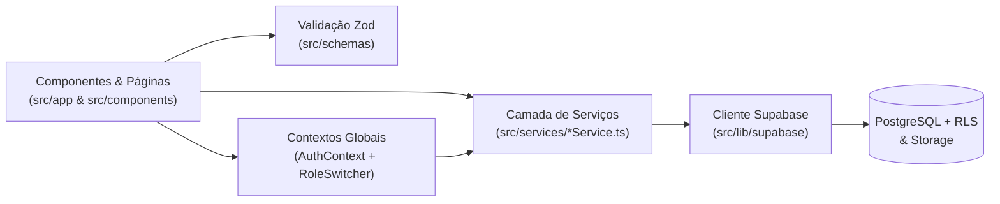
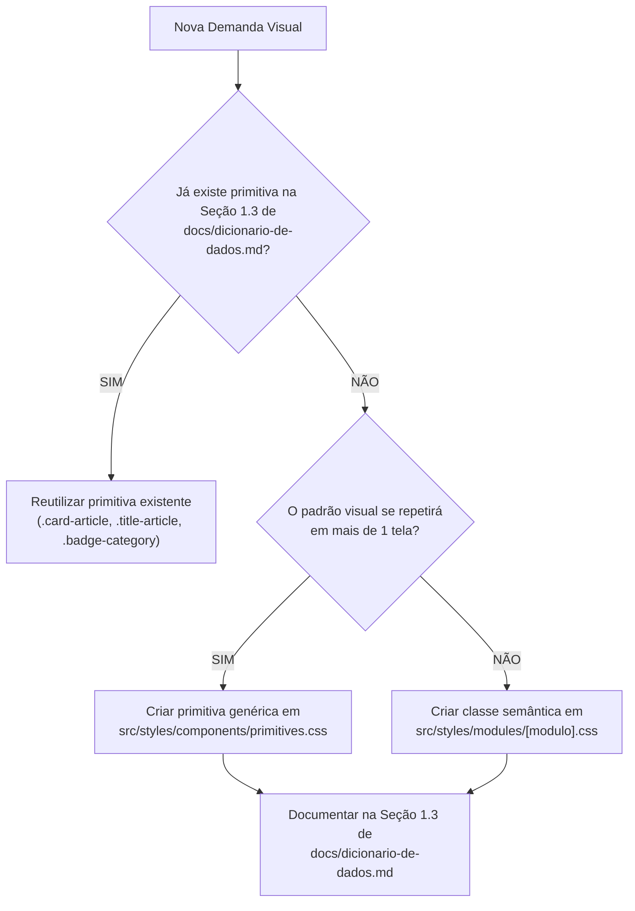

# 🛠️ Guia de Desenvolvimento & Arquitetura de Software | Aresta Revista

> **Arquivo:** `docs/guia-de-desenvolvimento.md`  
> **Finalidade:** Definir os padrões arquiteturais, a organização da camada de serviços completa (`src/services/`), o seletor de visão do protótipo (`PrototypeRoleSwitcher`), a governança de CSS (Anti-Class Boom), a compressão universal de capas (`image/jpeg`) e a estratégia de testes automatizados.  
> **Última Atualização:** 07/11/2026  
> **Nota DRY:** Para regras editoriais e fluxo `edicao` ⇄ `publicado`, consulte [`docs/regras-de-negocio.md`](./regras-de-negocio.md). Para tabelas SQL, tokens e o catálogo completo de classes CSS, consulte [`docs/dicionario-de-dados.md`](./dicionario-de-dados.md).

---

## 📑 Sumário

- [1. Stack Tecnológica Oficial](#1-stack-tecnológica-oficial)
- [2. Arquitetura em Camadas Desacopladas](#2-arquitetura-em-camadas-desacopladas)
  - [2.1 Fluxo Unidirecional de Dados](#21-fluxo-unidirecional-de-dados)
  - [2.2 Camada de Serviços Completa (`src/services/` — Repository Pattern)](#22-camada-de-serviços-completa-srcservices--repository-pattern)
  - [2.3 Estado Global, Mocks Reais & Seletor de Visão do Protótipo (`AuthContext.tsx` & `PrototypeRoleSwitcher.tsx`)](#23-estado-global-mocks-reais--seletor-de-visão-do-protótipo-authcontexttsx--prototyperoleswitchertsx)
  - [2.4 Validação Runtime com Zod (`src/schemas/`)](#24-validação-runtime-com-zod-srcschemas)
- [3. Engenharia de CSS: Modularização & Regra Anti-Class Boom](#3-engenharia-de-css-modularização--regra-anti-class-boom)
  - [3.1 Proibição de Cadeias Utilitárias Inline Gigantescas](#31-proibição-de-cadeias-utilitárias-inline-gigantescas)
  - [3.2 Hierarquia de Estilos (`src/styles/`)](#32-hierarquia-de-estilos-srcstyles)
  - [3.3 Protocolo "Primitiva Primeiro" & Matriz de Decisão](#33-protocolo-primitiva-primeiro--matriz-de-decisão)
- [4. Governança de Banco de Dados, Storage & Keep-Alive](#4-governança-de-banco-de-dados-storage--keep-alive)
  - [4.1 Nova Conta Dedicada no Supabase](#41-nova-conta-dedicada-no-supabase)
  - [4.2 Prevenção Ativa de Hibernação do Supabase (`Keep-Alive`)](#42-prevenção-ativa-de-hibernação-do-supabase-keep-alive)
  - [4.3 Migrations Versionadas & Tipagem End-to-End](#43-migrations-versionadas--tipagem-end-to-end)
  - [4.4 Bucket de Mídia & Compressão Client-Side Universal (`image/jpeg`)](#44-bucket-de-mídia--compressão-client-side-universal-imagejpeg)
- [5. Qualidade de Código, Testes Automatizados & Git Workflow](#5-qualidade-de-código-testes-automatizados--git-workflow)
  - [5.1 Suíte de Testes Automatizados (`Vitest`)](#51-suíte-de-testes-automatizados-vitest)
  - [5.2 Checklist Obrigatório Antes de Cada Commit/Deploy](#52-checklist-obrigatório-antes-de-cada-commitdeploy)

---

## 1. Stack Tecnológica Oficial

| Camada | Tecnologia / Versão | Papel na Arquitetura |
| :--- | :--- | :--- |
| **Framework Web** | **Next.js 15/16** (App Router, Turbopack, React 19) | Renderização híbrida: Server Components para SEO e vitrine + Client Components para editor e interatividade. |
| **Linguagem** | **TypeScript 5** (`strict: true`) | Segurança de tipos estrita e contratos de ponta a ponta. |
| **Estilização** | **Tailwind CSS 4** + CSS Custom Properties (`theme.css`) | Design tokens centralizados no carmim `#B91C1C`, primitivas semânticas e prevenção ativa de repetição. |
| **Backend & Banco** | **Supabase** (`@supabase/supabase-js`, `@supabase/ssr`) | PostgreSQL com Row Level Security (RLS), Autenticação Google OAuth e Storage de capas/avatares. |
| **Formulários & Schemas** | **React Hook Form** + **Zod** (`@hookform/resolvers`) | Validação estrita de inputs no navegador e higienização antes de persistir no banco. |
| **UI & Feedback** | **Lucide React** + **Sonner** | Ícones vetoriais modernos e notificações toast acessíveis e discretas. |
| **Testes & Qualidade** | **Vitest** + **ESLint** | Testes de unidade para serviços/cálculos e conformidade de código. |
| **Hospedagem & CI/CD** | **Vercel** | Deploy contínuo integrado ao repositório Git. |

---

## 2. Arquitetura em Camadas Desacopladas

### 2.1 Fluxo Unidirecional de Dados

Nenhum componente visual (`src/components/` ou `src/app/`) realiza chamadas SQL diretas ou instancia queries dispersas do Supabase no corpo do JSX. Toda a comunicação com dados respeita o fluxo unidirecional:



---

### 2.2 Camada de Serviços Completa (`src/services/` — Repository Pattern)

Concentra 100% das operações de dados e regras de negócio sob a **estratégia Mock-First** em **7 serviços especializados**:

> 💡 **Estratégia Mock-First (Integração Tardia):** Durante todo o desenvolvimento visual da aplicação (Sprints 0 a 4), os serviços operam fornecendo dados mockados tipados em memória e `localStorage`. Na Sprint 5 (Integração com o Banco), apenas o interior desses serviços é atualizado para chamar o cliente Supabase, mantendo as telas 100% intactas.

1. [`artigosService.ts`](../src/services/artigosService.ts):
   * Consultas da vitrine e feeds de artigos com `status = 'publicado'`;
   * Busca por termo/editoria e recuperação de artigo por slug com incremento seguro de visualização;
   * CRUD de artigos para o autor original (`edicao` e `publicado`), garantindo que **somente o autor titular (`autor_id`)** possa editar o texto ou alterar seu status para `'publicado'`;
   * Gestão dos destaques da capa (`eh_destaque_hero` e `eh_destaque_secao`) pelo Administrador.
2. [`revisaoService.ts`](../src/services/revisaoService.ts):
   * Listagem dedicada de todos os artigos em `status = 'edicao'` acessível apenas para usuários `autor` e `admin`;
   * Criação, listagem e marcação como resolvida das sugestões/comentários internos de revisão (`artigo_revisao_comentarios`) feitos por outros autores e administradores nos textos em edição.
3. [`autoresService.ts`](../src/services/autoresService.ts):
   * Consulta da página pública de perfil do colunista (`/autor/[slug]`);
   * Consulta dos metadados e acervo histórico da coluna titular (`/coluna-arquivo/[slug]`);
   * Listagem geral de usuários e alteração de papéis (`leitor` ⇄ `autor` ⇄ `admin`) pelo Administrador.
4. [`categoriasService.ts`](../src/services/categoriasService.ts):
   * Listagem e metadados das 6 editorias oficiais ativas.
5. [`interacoesService.ts`](../src/services/interacoesService.ts):
   * Comentários públicos de leitores autenticados em artigos publicados (`artigo_comentarios`) e moderação pelo Admin;
   * Artigos salvos/favoritos do leitor (`leitores_favoritos`);
   * Inscrição para seguir uma coluna específica (`coluna_seguidores`) e assinatura da Newsletter semanal (`newsletter_assinantes`).
6. [`authService.ts`](../src/services/authService.ts):
   * Gerenciamento de sessão, login com Google OAuth em 1 clique e alternância de persona no modo protótipo.
7. [`storageService.ts`](../src/services/storageService.ts):
   * Upload de capas de artigos e avatares no Supabase Storage pós-otimização em JPEG.

---

### 2.3 Estado Global, Mocks Reais & Seletor de Visão do Protótipo (`AuthContext.tsx` & `PrototypeRoleSwitcher.tsx`)

* **Dados Oficiais do Protótipo (`src/services/mocks/`):**
  * Os mocks utilizam os **5 autores reais envolvidos no projeto** (todos com `papel = 'autor'`, sendo que **todo autor é um admin e possui uma coluna obrigatória**):
    1. **Lucas Campos** (*Coluna de Lucas*)
    2. **Danillo Reis** (*Coluna de Danillo*)
    3. **Sergio Rodrigues** (*Coluna de Sergio*)
    4. **Lara Lima** (*Coluna de Lara*)
    5. **Guliver Elias** (*Coluna de Guliver*)
  * O dataset inicial do protótipo contempla **pelo menos 3 artigos de cada um dos 5 autores (mínimo de 15 textos)** distribuídos entre as **6 Editorias** (*Política & Poder*, *Cultura & Artes*, *Entretenimento & Pop*, *Subjetividades*, *Opinião & Ensaios* e *Esporte & Sociedade*).
* [`AuthContext.tsx`](../src/contexts/AuthContext.tsx): Mantém o estado da sessão ativa e expõe a função `alternarVisaoPrototipo(persona)` durante a Fase 1 (Mock-First).
* [`PrototypeRoleSwitcher.tsx`](../src/components/layout/PrototypeRoleSwitcher.tsx): Barra flutuante discreta (`.prototype-role-switcher`) posicionada no canto inferior direito do protótipo na Vercel, permitindo que você e seus avaliadores testem todas as regras de permissão em 1 clique:
  1. **✍️ Visão Autor/Admin Titular (ex: Lucas Campos — `lucas@aresta.com.br`):** Como todo autor é admin e titular de coluna, acessa tanto `/painel` quanto `/admin`, edita e publica os próprios textos da *Coluna de Lucas* (`edicao` → `publicado`) e vê/comenta textos em `'edicao'` dos colegas.
  2. **🤝 Visão Outro Autor/Admin (ex: Danillo Reis / Lara Lima / Sergio Rodrigues / Guliver Elias):** Permite alternar para qualquer um dos outros 4 autores para testar a escrita na própria coluna e visualizar os textos em `'edicao'` de Lucas Campos em modo somente leitura, enviando sugestões de melhoria sem poder alterar o texto alheio.
  3. **🛡️ Visão Admin Não-Autor (`admin@aresta.com.br`):** Demonstra a regra *"nem todo admin é autor"*: acessa `/admin`, gerencia destaques da capa e comenta sugestões nos textos em `'edicao'`, mas não possui coluna própria.
  4. **📖 Visão Leitor Logado (`leitor@aresta.com.br`):** Vê apenas artigos com `status = 'publicado'`, pode comentar nos artigos públicos e favoritar textos.
  5. **👀 Visitante Anônimo (Deslogado):** Lê livremente os artigos publicados e visualiza o convite de login Google ao tentar comentar.

---

### 2.4 Validação Runtime com Zod (`src/schemas/`)

* [`artigoSchema.ts`](../src/schemas/artigoSchema.ts): Validação de títulos (10-140 caracteres), linha-fina/lead (20-280 caracteres), editoria obrigatória, corpo textual e status (`'edicao' | 'publicado'`).
* [`revisaoSchema.ts`](../src/schemas/revisaoSchema.ts): Validação de comentários/sugestões internas de outros autores e admins em textos em edição.
* [`autorSchema.ts`](../src/schemas/autorSchema.ts): Validação de bio, manifesto da coluna, slug em kebab-case e links sociais.

---

## 3. Engenharia de CSS: Modularização & Regra Anti-Class Boom

### 3.1 Proibição de Cadeias Utilitárias Inline Gigantescas
1. É **estritamente proibido** aninhar dezenas de classes utilitárias no JSX (`className="flex flex-col md:flex-row items-center justify-between text-xs font-semibold py-2 px-4 rounded-xl border border-stone-200 ..."`).
2. O código JSX deve ser legível, limpo e focado na estrutura, utilizando o catálogo da Seção 1.3 de [`docs/dicionario-de-dados.md`](./dicionario-de-dados.md).

---

### 3.2 Hierarquia de Estilos (`src/styles/`)

```text
src/styles/
├── theme.css                  # Tokens universais (--color-brand-accent: #B91C1C, fontes, modo claro/escuro)
├── components/                # Primitivas universais reutilizáveis em qualquer parte da revista
│   ├── primitives.css         # .card-*, .title-*, .text-*, .badge-*, .grid-*, .author-signature
│   ├── buttons.css            # .btn-primary, .btn-accent, .btn-outline, .btn-ghost
│   ├── forms.css              # .input-field, .label-field, .textarea-editor
│   ├── modals.css             # .modal-backdrop, .modal-container
│   └── layout.css             # .header-editorial-frosted, .main-content-layout, .reading-progress, .prototype-role-switcher
└── modules/                   # Estilos específicos de fluxos especializados
    ├── capa.css               # Detalhes específicos da capa editorial
    ├── leitura.css            # Barra de conforto visual, quote card e elementos de leitura
    ├── autor.css              # Cabeçalho de perfil (/autor/[slug]) e acervo (/coluna-arquivo/[slug])
    ├── painel.css             # Editor Tiptap e bancada de sugestões colaborativas
    └── admin.css              # Mesa editorial (/admin) e seletor de destaques da capa
```

---

### 3.3 Protocolo "Primitiva Primeiro" & Matriz de Decisão



---

## 4. Governança de Banco de Dados, Storage & Keep-Alive

### 4.1 Nova Conta Dedicada no Supabase
* Para o deploy oficial em produção e integração com o banco (Sprint 5), **será criada uma conta nova dedicada no Supabase** (utilizando um e-mail novo), garantindo 2 novos slots de projetos gratuitos e independência total de outros projetos pessoais.

### 4.2 Prevenção Ativa de Hibernação do Supabase (`Keep-Alive`)
* No plano gratuito, instâncias do Supabase pausam após 7 dias de inatividade de consultas no PostgreSQL.
* Para garantir **disponibilidade contínua 24/7 sem adormecer**, um Cron Job nativo no `vercel.json` dispara diariamente às 12:00 UTC para `/api/keep-alive`, executando `SELECT id FROM categorias LIMIT 1`.

### 4.3 Migrations Versionadas & Tipagem End-to-End
* Qualquer alteração de esquema no PostgreSQL deve ser registrada em `supabase/migrations/20261107_init_schema.sql` e refletida em `src/types/database.types.ts` e `docs/dicionario-de-dados.md`.

### 4.4 Bucket de Mídia & Compressão Client-Side Universal (`image/jpeg`)
* Para garantir **100% de compatibilidade** com o gerador de cards dinâmicos `@vercel/og` (motor Satori na Edge) e com os crawlers de pré-visualização do WhatsApp, X e Instagram (que frequentemente falham ao ler arquivos `.webp` externos):
  * O utilitário `src/lib/imageOptimizer.ts` redimensiona as imagens no navegador (proporção 16:9 até `1200x675px` para capas; `400x400px` para avatares) e comprime via Canvas API para **`image/jpeg` (qualidade `0.82`, peso $\le 120\text{ KB}$)**;
  * As imagens otimizadas são gravadas no bucket `artigos-capas` do Supabase Storage com URLs públicas.

---

## 5. Qualidade de Código, Testes Automatizados & Git Workflow

### 5.1 Suíte de Testes Automatizados (`Vitest`)
Os testes unitários devem cobrir principalmente:
* Funções de utilitário (cálculo de tempo de leitura de 200 ppm, normalização de slug, formatação de datas);
* Validações de schemas Zod (`artigoSchema`, `revisaoSchema`, `autorSchema`);
* Regras de permissão nos serviços (garantindo que apenas o `autor_id` original consiga editar o texto ou mudar o status de `'edicao'` para `'publicado'`, enquanto outros autores e admins conseguem adicionar comentários em `revisaoService`).

### 5.2 Checklist Obrigatório Antes de Cada Commit/Deploy

```bash
# 1. Verificar tipagem estrita
npx tsc --noEmit

# 2. Executar linter sem avisos críticos
npm run lint

# 3. Rodar suíte de testes unitários
npm test
```
* **Critério de Aceite:** 0 erros de compilação TypeScript e conformidade total com o guia.
