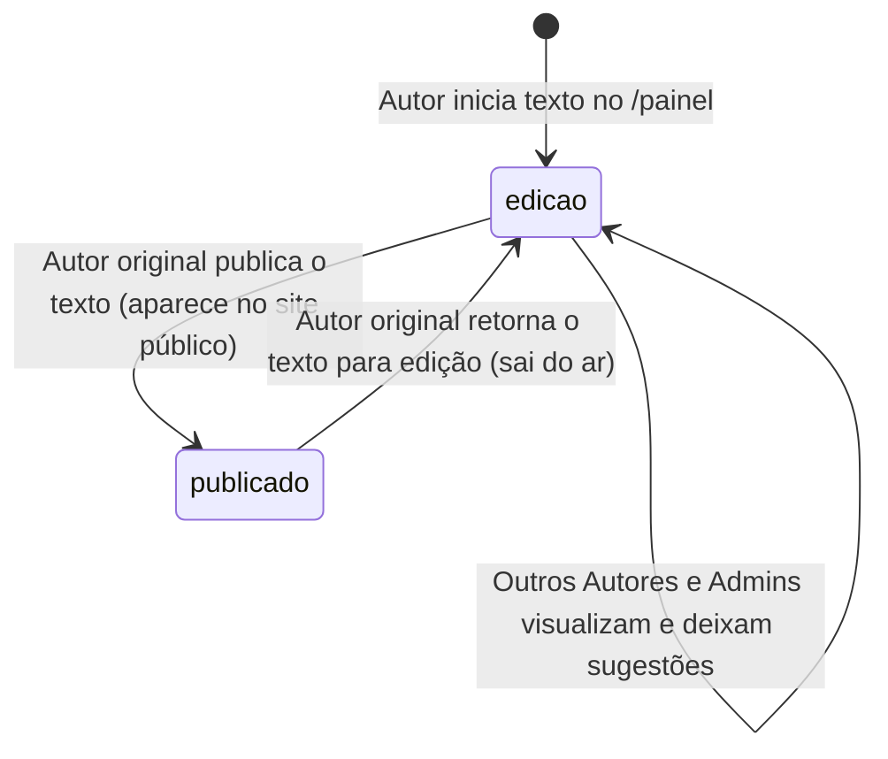
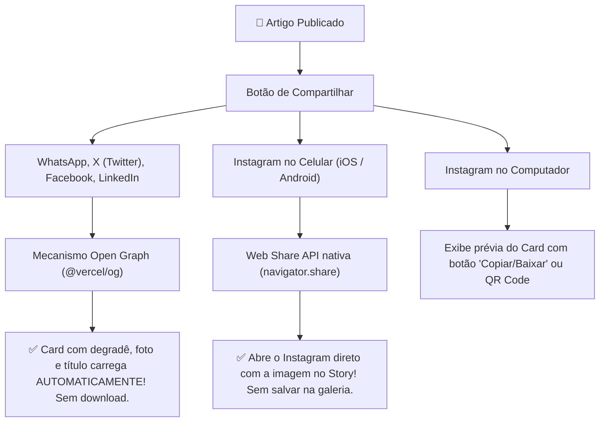

# 📋 Regras de Negócio Oficiais & Especificação de Domínio | Aresta Revista

> **Arquivo:** `docs/regras-de-negocio.md`  
> **Finalidade:** Fonte única da verdade para todas as regras editoriais, modelo de colunas autorais e páginas de autor, relação entre Autor e Admin, taxonomia temática (5 editorias), ciclo de vida dos artigos (`edicao` e `publicado`), elenco oficial de autores do protótipo e compartilhamento visual dinâmico.  
> **Última Atualização:** 07/11/2026

---

## 📑 Sumário

- [1. Modelo Editorial: Autores, Perfis & Colunas Autorais](#1-modelo-editorial-autores-perfis--colunas-autorais)
  - [1.1 Conceito da Coluna Titular vs. Perfil do Colunista](#11-conceito-da-coluna-titular-vs-perfil-do-colunista)
  - [1.2 Elenco Oficial de Autores & Colunas do Protótipo](#12-elenco-oficial-de-autores--colunas-do-protótipo)
  - [1.3 As 5 Editorias Centrais](#13-as-6-editorias-centrais)
  - [1.4 Sistema de Tags Livres](#14-sistema-de-tags-livres)
- [2. Perfis de Usuário & Níveis de Acesso (RBAC)](#2-perfis-de-usuário--níveis-de-acesso-rbac)
  - [2.1 Regra Fundamental: "Todo Autor é um Admin, mas nem todo Admin é Autor"](#21-regra-fundamental-todo-autor-é-um-admin-mas-nem-todo-admin-é-autor)
  - [2.2 Tabela de Papéis (`leitor`, `admin`, `autor`)](#22-tabela-de-papéis-leitor-admin-autor)
- [3. Ciclo de Vida do Artigo & Revisão Colaborativa](#3-ciclo-de-vida-do-artigo--revisão-colaborativa)
  - [3.1 Os 2 Estados do Artigo (`status_artigo`)](#31-os-2-estados-do-artigo-status_artigo)
  - [3.2 Autonomia de Publicação do Autor Original](#32-autonomia-de-publicação-do-autor-original)
  - [3.3 Vitrine Interna de Textos em Edição & Comentários de Revisão](#33-vitrine-interna-de-textos-em-edição--comentários-de-revisão)
- [4. Capa Editorial & Sistema de Destaques](#4-capa-editorial--sistema-de-destaques)
  - [4.1 Estrutura da Home (Desktop ⇄ Mobile)](#41-estrutura-da-home-desktop--mobile)
  - [4.2 Manchete Principal (*Hero Article*)](#42-manchete-principal-hero-article)
  - [4.3 Vitrine "Últimas das Colunas"](#43-vitrine-últimas-das-colunas)
  - [4.4 Feeds por Editoria](#44-feeds-por-editoria)
- [5. Leitura Imersiva & Recursos do Leitor](#5-leitura-imersiva--recursos-do-leitor)
  - [5.1 Tempo Estimado de Leitura & Barra de Progresso](#51-tempo-estimado-de-leitura--barra-de-progresso)
  - [5.2 Modo de Conforto Visual (Tamanho de Fonte & Temas)](#52-modo-de-conforto-visual-tamanho-de-fonte--temas)
  - [5.3 Quote Card: Compartilhamento de Citação Flutuante](#53-quote-card-compartilhamento-de-citação-flutuante)
  - [5.4 Recomendações no Rodapé](#54-recomendações-no-rodapé)
  - [5.5 Comentários Públicos Autenticados com Google](#55-comentários-públicos-autenticados-com-google)
- [6. Mecanismo de Compartilhamento Visual Automático](#6-mecanismo-de-compartilhamento-visual-automático)
  - [6.1 Open Graph Dinâmico (WhatsApp, X, Facebook, LinkedIn)](#61-open-graph-dinâmico-whatsapp-x-facebook-linkedin)
  - [6.2 Instagram Stories via Web Share API Nativa](#62-instagram-stories-via-web-share-api-nativa)
  - [6.3 Anatomia Visual do Card Dinâmico](#63-anatomia-visual-do-card-dinâmico)
- [7. Newsletter Semanal & Assinatura de Coluna](#7-newsletter-semanal--assinatura-de-coluna)
  - [7.1 Edição Semanal da Revista](#71-edição-semanal-da-revista)
  - [7.2 Seguir Colunista Específico](#72-seguir-colunista-específico)
- [8. Política de Mídia, Imagens & Compatibilidade Open Graph](#8-política-de-mídia-imagens--compatibilidade-open-graph)
- [9. SEO Editorial e Metadados](#9-seo-editorial-e-metadados)

---

## 1. Modelo Editorial: Autores, Perfis & Colunas Autorais

### 1.1 Conceito da Coluna Titular vs. Perfil do Colunista

Na **Aresta Revista**, **todo autor possui obrigatoriamente uma Coluna Exclusiva**, mantendo duas páginas públicas complementares e bem definidas:

1. **Página de Perfil do Colunista (`/autor/[slug]`):**
   * Focada na **pessoa e trajetória do autor**;
   * Exibe foto em destaque, biografia completa, áreas de atuação, links para redes sociais (`X/Twitter`, `Instagram`, `LinkedIn`, `Website`);
   * Apresenta o cartão de destaque da sua **Coluna Titular** (com botão para acessar o acervo completo) e os 3 artigos mais recentes publicados por ele.
2. **Página de Acervo da Coluna (`/coluna-arquivo/[slug]`):**
   * Focada na **publicação autoral periódica (a Coluna)**;
   * Exibe o nome próprio da coluna (ex: *"Coluna de Lucas"*, *"Coluna de Lara"*), o banner/selo visual e o manifesto/slogan da coluna;
   * Oferece o botão **"Seguir esta Coluna"** (para receber novos textos por e-mail), busca rápida dentro da coluna e a **listagem cronológica completa (acervo)** de todos os artigos publicados pelo colunista.

* Cada artigo pertence à **Coluna do Autor** e é classificado em **1 das 5 grandes Editorias temáticas**.

---

### 1.2 Elenco Oficial de Autores & Colunas do Protótipo

Os dados gerados para o protótipo (mocks oficiais e seed inicial) utilizam os nomes reais dos 5 integrantes do projeto, cada um titular de sua respectiva coluna e contando com **pelo menos 3 artigos por autor (mínimo de 15 textos no total)** distribuídos entre as 5 editorias:

| # | Autor Titular (`papel = 'autor'`) | Slug do Perfil (`/autor/[slug]`) | Nome da Coluna | Slug da Coluna (`/coluna-arquivo/[slug]`) | Mínimo de Textos no Protótipo |
| :-: | :--- | :--- | :--- | :--- | :---: |
| **1** | **Lucas Campos** | `/autor/lucas-campos` | Coluna de Lucas | `/coluna-arquivo/coluna-de-lucas` | $\ge 3$ textos (divididos nas editorias) |
| **2** | **Danillo Reis** | `/autor/danillo-reis` | Coluna de Danillo | `/coluna-arquivo/coluna-de-danillo` | $\ge 3$ textos (divididos nas editorias) |
| **3** | **Sergio Rodrigues** | `/autor/sergio-rodrigues` | Coluna de Sergio | `/coluna-arquivo/coluna-de-sergio` | $\ge 3$ textos (divididos nas editorias) |
| **4** | **Lara Lima** | `/autor/lara-lima` | Coluna de Lara | `/coluna-arquivo/coluna-de-lara` | $\ge 3$ textos (divididos nas editorias) |
| **5** | **Guliver Elias** | `/autor/guliver-elias` | Coluna de Guliver | `/coluna-arquivo/coluna-de-guliver` | $\ge 3$ textos (divididos nas editorias) |

---

### 1.3 As 5 Editorias Centrais

```text
                                         ARESTA REVISTA
                                               │
         ┌───────────────┬───────────────┬─────┴─────────┬───────────────┬───────────────┐
         ▼               ▼               ▼               ▼               ▼               ▼
    1. POLÍTICA     2. CULTURA     3. ENTRETENIMENTO 4. SUBJETIVIDADES 5. OPINIÃO   6. ESPORTE
      & PODER         & ARTES           & POP                           & ENSAIOS     & SOCIEDADE
```

1. **Política & Poder:** Análise de conjuntura nacional e internacional, instituições, cidadania, políticas públicas e disputas democráticas.
2. **Cultura & Artes:** Literatura, artes plásticas, música, teatro, cinema de autor, patrimônio e crítica estética.
3. **Entretenimento & Pop:** Streaming, séries, televisão, universos ficcionais, internet e fenômenos da cultura digital de massa.
4. **Subjetividades:** Crônicas intimistas, psicanálise, comportamento, autoficção, memória, afetos e o cotidiano contemporâneo.
5. **Opinião & Ensaios:** Artigos de fundo, debates teóricos aprofundados e reflexões filosóficas.
6. **Esporte & Sociedade:** Análises culturais do futebol e do desporto, bastidores, táticas e seu entrelaçamento com a sociedade.

### 1.4 Sistema de Tags Livres

* Cada artigo recebe de 1 a 5 tags livres para cruzar temas entre editorias (ex: `eleicoes-2026`, `oscar`, `psicanalise`, `futebol-arte`, `literatura-brasileira`).

---

## 2. Perfis de Usuário & Níveis de Acesso (RBAC)

### 2.1 Regra Fundamental: "Todo Autor é um Admin, mas nem todo Admin é Autor"

Na governança coletiva da **Aresta Revista**, os colunistas fazem parte da direção editorial do portal:

> ⚠️ **REGRA DE DOMÍNIO OBRIGATÓRIA:**
> 1. **Todo Autor é um Admin (`autor` $\implies$ permissões de `admin`):** Qualquer usuário com papel `'autor'` possui automaticamente **todas as permissões administrativas do portal** (acesso a `/admin`, escolha da manchete *Hero* e destaques da capa, visualização de todos os textos em `'edicao'`, comentários de revisão e gestão de usuários), **além** de possuir obrigatoriamente uma **Coluna Exclusiva (`colunas`)** e publicar seus próprios artigos em `/painel`.
> 2. **Nem todo Admin é Autor (`admin` sem coluna):** Um usuário com papel `'admin'` possui todas as permissões de administração, suporte técnico e curadoria da revista (`/admin` e visualização/sugestões de textos em `'edicao'`), mas **não é titular de uma coluna nem assina/publica artigos como colunista**.
> 3. **Todo Autor tem uma Coluna:** Não existe autor sem coluna vinculada (`1:1` obrigatório entre usuário `'autor'` e registro na tabela `colunas`).

---

### 2.2 Tabela de Papéis (`leitor`, `admin`, `autor`)

| Papel (`papel_usuario`) | Possui Coluna? | Permissões no Sistema |
| :--- | :---: | :--- |
| **`leitor`** | ❌ Não | • Leitura 100% aberta e livre de qualquer barreira para artigos com `status = 'publicado'`.<br>• Pode fazer login com Google em 1 clique para comentar textos públicos e salvar favoritos.<br>• Pode assinar a newsletter geral ou seguir colunas individuais. |
| **`admin`** *(Admin Não-Autor)* | ❌ Não | • Acessa `/admin` e gerencia a grade de destaques da Capa (*Hero Article* `eh_destaque_hero` e destaques de seção `eh_destaque_secao`).<br>• Visualiza a listagem de todos os textos em `edicao` dos autores e pode deixar comentários/sugestões de melhoria (`artigo_revisao_comentarios`), sem editar ou publicar o texto alheio.<br>• Modera comentários públicos e gerencia usuários/papéis (`leitor`, `admin`, `autor`). |
| **`autor`** *(Colunista + Admin)* | ✅ **Sim (Obrigatória)** | • **Acumula 100% das permissões de `admin` descritas acima.**<br>• É titular de sua própria Coluna com página de perfil (`/autor/[slug]`) e página de acervo (`/coluna-arquivo/[slug]`).<br>• Cria, edita, exclui e **publica** exclusivamente os seus próprios textos em `/painel` (somente o autor original pode alterar seu texto ou mudar seu status para `publicado`).<br>• Visualiza textos em `edicao` dos demais autores e deixa comentários/sugestões para os colegas. |

---

## 3. Ciclo de Vida do Artigo & Revisão Colaborativa

### 3.1 Os 2 Estados do Artigo (`status_artigo`)

O fluxo de publicação é direto, sem burocracia de agendamento: todo artigo possui apenas **dois estados**:



1. **`edicao` (Em Edição):**
   * O texto está sendo escrito ou aprimorado pelo seu autor.
   * **Visibilidade restrita:** Invisível no site público (leitores não têm acesso). Disponível para leitura interna apenas para usuários com papel `autor` e `admin`.
2. **`publicado` (Publicado):**
   * O texto aparece imediatamente no site público (capa, editorias, acervo da coluna `/coluna-arquivo/[slug]`, perfil `/autor/[slug]`, busca e SEO).

### 3.2 Autonomia de Publicação do Autor Original

> ⚠️ **REGRA DE OURO DE AUTORIA:**  
> * **Apenas o autor original do artigo (`autor_id = auth.uid()`)** tem permissão para modificar o título, subtítulo, capa ou corpo do texto.  
> * **Apenas o autor original do artigo** pode mudar o status do seu texto de `'edicao'` para `'publicado'` (ou reverter de `'publicado'` para `'edicao'`). Mesmo que todos os autores sejam admins, nenhum usuário altera ou publica o texto de outro autor.

### 3.3 Vitrine Interna de Textos em Edição & Comentários de Revisão

Para estimular a troca intelectual e o cuidado editorial entre Lucas Campos, Danillo Reis, Sergio Rodrigues, Lara Lima, Guliver Elias e demais administradores:
* No Painel (`/painel` e `/admin`), existe uma listagem dedicada a todos os artigos que estão atualmente com `status = 'edicao'`.
* Ao abrir um artigo em edição de outro colunista, o texto é exibido em **modo somente leitura** acompanhado de um **Painel Lateral de Sugestões e Comentários Internos (`artigo_revisao_comentarios`)**.
* Outros autores e administradores podem publicar comentários construtivos e sugestões de modificações naquele texto, enquanto somente o autor original pode editar o texto e clicar em **Publicar**.

---

## 4. Capa Editorial & Sistema de Destaques

### 4.1 Estrutura da Home (Desktop ⇄ Mobile)
A capa foi desenhada para respirar, oferecendo clareza e ritmo visual sem poluição de banners:

* **Desktop:**
  * Header fixo superior (*frosted glass*) com divisória sutil: logotipo `aresta.` em serifa clássica com ponto carmim, links das 5 editorias, botão *"Colunistas"*, busca e botão *"Newsletter"*.
  * Faixa editorial do dia (data, lema da revista e indicador de última edição).
  * Grade *Hero*: Manchete principal de grande impacto + 2 apoios laterais (`eh_destaque_secao`).
  * Vitrine horizontal: *"Últimas das Colunas"* (foto do autor + nome da coluna + título do texto, linkando para o artigo e para `/coluna-arquivo/[slug]`).
  * Blocos verticais alternados para cada uma das 5 editorias.
* **Mobile:**
  * Barra superior compacta com menu gaveta (*drawer*) e busca rápida.
  * Barra horizontal de rolagem suave com as 5 editorias em pílulas (*chips*).
  * Cards empilhados verticalmente com imagens em proporção 16:9 de toque confortável.

### 4.2 Manchete Principal (*Hero Article*)
* Apenas 1 artigo publicado por vez ostenta `eh_destaque_hero = true`.
* A seleção do Hero é feita no `/admin` (por qualquer `autor` ou `admin` dentre os artigos com `status = 'publicado'`), e o sistema automaticamente desmarca o destaque anterior.

### 4.3 Vitrine "Últimas das Colunas"
* Exibe o artigo publicado mais recente de cada uma das colunas ativas (*Coluna de Lucas*, *Coluna de Danillo*, *Coluna de Sergio*, *Coluna de Lara*, *Coluna de Guliver*).

---

## 5. Leitura Imersiva & Recursos do Leitor

### 5.1 Tempo Estimado de Leitura & Barra de Progresso
* Cálculo automático no salvamento baseado na média de 200 palavras por minuto:
  $$\text{tempo\_leitura\_min} = \max\left(1, \left\lceil \frac{\text{palavras}}{200} \right\rceil\right)$$
* Barra de progresso sutil de 2px em vermelho carmim (`#B91C1C`) no topo do cabeçalho que preenche conforme a rolagem do artigo.

### 5.2 Modo de Conforto Visual (Tamanho de Fonte & Temas)
No topo da coluna de leitura, uma barra discreta de ferramentas oferece:
* **Tamanho de Fonte:** Controles `[A-]` e `[A+]` (alternando entre 16px, 18px e 21px).
* **Temas de Leitura:**
  * *Padrão (Off-White Editorial):* Fundo linho suave `--color-paper-bg` (`#FBFBF9`) com tinta profunda.
  * *Branco Puro:* Fundo branco `--color-paper-surface` (`#FFFFFF`) de alto contraste.
  * *Modo Noturno (Dark):* Fundo preto carvão (`#09090B`) para leitura no escuro.

### 5.3 Quote Card: Compartilhamento de Citação Flutuante
* Ao selecionar qualquer trecho de texto no artigo com o mouse ou toque no celular, surge um menu flutuante: **"Criar Card de Citação"**.
* O leitor pode compartilhar imediatamente a citação formatada em card visual com aspas tipográficas carmim, o nome do colunista e o link da coluna.

### 5.4 Recomendações no Rodapé
Ao fim de cada leitura, logo abaixo da assinatura do colunista (que traz link tanto para o Perfil `/autor/[slug]` quanto para o Acervo da Coluna `/coluna-arquivo/[slug]`):
* Card *"Mais desta Coluna"*: o artigo imediatamente anterior do mesmo autor.
* 2 Cards *"Mais em [Editoria]"*: leituras complementares na mesma categoria.

### 5.5 Comentários Públicos Autenticados com Google
* A leitura é 100% aberta, mas o formulário de comentários públicos no rodapé do artigo exige login com Google em 1 clique para inibir spams e perfis falsos.

---

## 6. Mecanismo de Compartilhamento Visual Automático

O portal implementa geração dinâmica de imagens com `@vercel/og` (baseado em Satori/HTML-to-Image na Edge):



### 6.1 Open Graph Dinâmico (WhatsApp, X, Facebook, LinkedIn)
* Ao clicar no botão da rede social, o link do artigo é enviado via URL padrão (`https://wa.me/?text=...` ou `https://twitter.com/intent/tweet?url=...`).
* O robô da rede social lê a meta tag `<meta property="og:image" content="...">` e já exibe o card completo automaticamente.

### 6.2 Instagram Stories via Web Share API Nativa
* Nos celulares (iOS Safari e Android Chrome), a função de compartilhamento para Instagram utiliza a **Web Share API nativa** (`navigator.share({ files: [cardImageFile] })`) com imagem vertical (`1080x1920`).

### 6.3 Anatomia Visual do Card Dinâmico
* **Fundo:** Foto oficial de capa do artigo;
* **Máscara:** Gradiente escuro vertical sofisticado (`linear-gradient(to top, rgba(15,23,42,0.92) 0%, rgba(15,23,42,0.4) 60%, transparent 100%)`);
* **Topo:** Pílula da Editoria em caixa alta com cor temática;
* **Centro/Inferior:** Título da coluna em tipografia serifa de grande escala;
* **Rodapé:** Avatar redondo do colunista + Nome do Colunista + Nome da Coluna + Logotipo oficial **`aresta.`** com ponto carmim.

---

## 7. Newsletter Semanal & Assinatura de Coluna

### 7.1 Edição Semanal da Revista
* Captura de e-mail na home, no menu e no final dos artigos ("Receba a Edição Semanal da Aresta").

### 7.2 Seguir Colunista Específico
* Na página de acervo da coluna (`/coluna-arquivo/[slug]`), no perfil (`/autor/[slug]`) e no final de cada artigo, o leitor pode clicar em *"Seguir esta Coluna"*.

---

## 8. Política de Mídia, Imagens & Compatibilidade Open Graph

* **Next.js Image:** `images: { unoptimized: true }` no `next.config.ts`.
* **Compressão Client-Side Universal em JPEG Progressivo (`image/jpeg`):**
  * O utilitário `src/lib/imageOptimizer.ts` redimensiona a imagem no navegador via HTML5 Canvas (`1200x675px` proporção 16:9 para capas; `400x400px` para avatares) e exporta em **`image/jpeg` com qualidade `0.82`** ($\le 120\text{ KB}$ para capas e $\le 50\text{ KB}$ para avatares), garantindo 100% de compatibilidade com `@vercel/og` (Satori), WhatsApp e Instagram.
* **Créditos Obrigatórios:** Campo de créditos e legenda para garantia de direitos autorais.

---

## 9. SEO Editorial e Metadados

* **URLs Semânticas e Únicas:**
  * `/coluna/[slug]` para leitura de artigos publicados;
  * `/coluna-arquivo/[slug]` para o acervo histórico da coluna do autor;
  * `/autor/[slug]` para a página biográfica de perfil do colunista;
  * `/editoria/[slug]` para o arquivo de uma das 5 editorias.
* **Schema.org:** Injeção de JSON-LD como `NewsArticle` ou `BlogPosting`.
* **Sitemap Dinâmico:** `/sitemap.xml` contemplando todos os artigos com `status = 'publicado'`, páginas de acervo de colunas (`/coluna-arquivo/[slug]`) e perfis de colunistas (`/autor/[slug]`).
