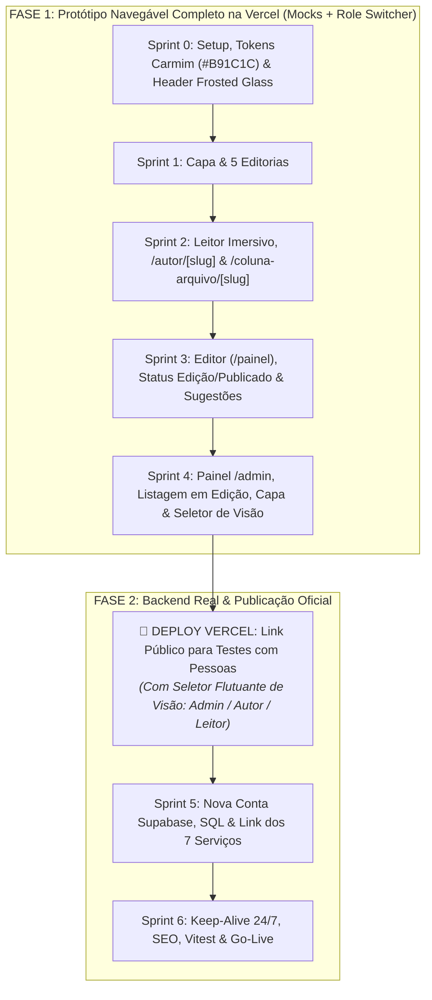

# 🚀 Roteiro de Sprints, Plano de Desenvolvimento & Go-Live | Aresta Revista

> **Arquivo:** `docs/roteiro-sprints.md`  
> **Finalidade:** Estruturar o cronograma de desenvolvimento da revista sob a estratégia **Protótipo Navegável Completo (Mock-First)** para testes públicos na Vercel (com Seletor Flutuante de Visão `PrototypeRoleSwitcher`, fluxo de 2 estados `edicao` e `publicado` e revisão colaborativa entre autores/admins), seguido pela integração ao Supabase e Go-Live oficial.  
> **Última Atualização:** 07/11/2026

---

## 📑 Sumário

- [1. Visão Geral da Estratégia de Desenvolvimento & Prototipagem](#1-visão-geral-da-estratégia-de-desenvolvimento--prototipagem)
- [2. Detalhamento das Sprints](#2-detalhamento-das-sprints)
  - [2.1 Sprint 0: Fundação, Tokens Carmim (#B91C1C) & Design System Editorial](#21-sprint-0-fundação-tokens-carmim-b91c1c--design-system-editorial)
  - [2.2 Sprint 1: Capa Editorial & Navegação pelas 5 Editorias (Mock-First)](#22-sprint-1-capa-editorial--navegação-pelas-6-editorias-mock-first)
  - [2.3 Sprint 2: Leitor Imersivo, Perfil (/autor) & Acervo da Coluna (/coluna-arquivo)](#23-sprint-2-leitor-imersivo-perfil-autor--acervo-da-coluna-coluna-arquivo)
  - [2.4 Sprint 3: Editor do Autor (/painel), Publicação Autônoma & Revisão Colaborativa](#24-sprint-3-editor-do-autor-painel-publicação-autônoma--revisão-colaborativa)
  - [2.5 Sprint 4: Painel Admin (/admin), Textos em Edição, Destaques da Capa & Seletor de Visão](#25-sprint-4-painel-admin-admin-textos-em-edição-destaques-da-capa--seletor-de-visão)
  - [2.6 MARCO INTERMEDIÁRIO: Deploy do Protótipo Navegável Completo na Vercel](#26-marco-intermediário-deploy-do-protótipo-navegável-completo-na-vercel)
  - [2.7 Sprint 5: Nova Conta no Supabase, Migrations & Integração com o Banco](#27-sprint-5-nova-conta-no-supabase-migrations--integração-com-o-banco)
  - [2.8 Sprint 6: Prevenção de Hibernação (Keep-Alive), SEO, Vitest & Go-Live](#28-sprint-6-prevenção-de-hibernação-keep-alive-seo-vitest--go-live)
- [3. Checklist de Transição: Dos Mocks para o Supabase Oficial](#3-checklist-de-transição-dos-mocks-para-o-supabase-oficial)
- [4. Backlog de Evoluções Futuras (Pós-Lançamento)](#4-backlog-de-evoluções-futuras-pós-lançamento)

---

## 1. Visão Geral da Estratégia de Desenvolvimento & Prototipagem

Adotamos a estratégia **Protótipo Navegável Completo na Vercel**: desenvolvemos 100% da interface do usuário — páginas públicas, perfil do colunista (`/autor/[slug]`), acervo da coluna (`/coluna-arquivo/[slug]`), painel do autor (`/painel`) e administração (`/admin`) — utilizando mocks tipados nos 7 serviços de `src/services/` e incluindo o **Seletor Flutuante de Visão (`PrototypeRoleSwitcher`)**.

Isso gera um **link público na Vercel** (`aresta-revista.vercel.app`) pronto para ser compartilhado via WhatsApp com parceiros e colunistas, que poderão alternar entre as visões (`Admin`, `Autor Titular`, `Autor Convidado`, `Leitor` e `Anônimo`) para testar tanto a leitura quanto a escrita e os comentários colaborativos em textos em edição.

| Sprint | Foco Principal | Estado de Dados / Sessão | Entregáveis Técnicos |
| :---: | :--- | :---: | :--- |
| **Sprint 0** | Fundação & Design System Editorial | N/A | Next.js 15/16, Tailwind 4, `theme.css` (destaque `#B91C1C`), primitivas semânticas, Header *frosted glass* e `.main-content-layout`. |
| **Sprint 1** | Capa Editorial & 5 Editorias | Mock-First | Capa com Manchete Hero, vitrine *"Últimas das Colunas"*, mosaicos das 5 editorias e busca textual (`/busca`). |
| **Sprint 2** | Leitor, Perfil do Autor & Acervo da Coluna | Mock-First | Leitor em `/coluna/[slug]`, página biográfica em `/autor/[slug]` e acervo completo da coluna em `/coluna-arquivo/[slug]`. |
| **Sprint 3** | Editor, Publicação Autônoma & Revisão | Mock / Autores | Rota `/painel`, editor Tiptap, status `'edicao'` ⇄ `'publicado'` (exclusivo do autor dono) e mural de sugestões para outros autores. |
| **Sprint 4** | Painel `/admin`, Destaques & Seletor de Visão | **Role Switcher Ativo** | Rota `/admin` com listagem de textos em `'edicao'` (leitura + sugestões), gestão da capa (Hero) e componente `PrototypeRoleSwitcher`. |
| **MARCO** | **Deploy do Protótipo na Vercel** | **Link Público de Teste** | Publicação do link oficial de testes para compartilhar no WhatsApp e coletar feedbacks reais. |
| **Sprint 5** | Nova Conta Supabase & Banco Real | PostgreSQL / RLS | Criação de conta nova no Supabase, execução de `20261107_init_schema.sql`, Google OAuth e virada dos 7 serviços. |
| **Sprint 6** | Keep-Alive, SEO & Go-Live | Produção Oficial | Cron Job Keep-Alive (`vercel.json`), tags Open Graph dinâmicas (`image/jpeg`), suíte Vitest e virada de domínio. |

---

## 2. Detalhamento das Sprints

### 2.1 Sprint 0: Fundação, Tokens Carmim (#B91C1C) & Design System Editorial
- [x] Inicialização da aplicação Next.js (App Router, TypeScript estrito, Turbopack, Tailwind CSS 4).
- [x] Configuração do design system editorial em `src/styles/theme.css` (com cor de destaque centralizada em `--color-brand-accent: #B91C1C`) e das classes semânticas documentadas no dicionário de dados (`primitives.css`, `layout.css`, `buttons.css`, `forms.css`, `modals.css`).
- [x] Construção do Header fixo com efeito *frosted glass* (`backdrop-filter: blur(12px)`) e logotipo `aresta.`.
- [x] Implementação obrigatória da classe `.main-content-layout` com padding superior padronizado (`4.5rem` desktop / `4rem` mobile).
- [x] Configuração de tipagem de domínio (`database.types.ts`, `artigo.types.ts`, `autor.types.ts`) e utilitários com testes (`readingTime`, `slugify`).
- [x] Validação com 0 erros: `npx tsc --noEmit`, `npm run lint` e `npx vitest run` (9 testes aprovados).
- [x] Compilação estática (`npm run build`) validada com sucesso.

### 2.2 Sprint 1: Capa Editorial & Navegação pelas 5 Editorias (Mock-First)
- [x] Criação dos mocks tipados para os serviços em `src/services/mocks/` utilizando os **5 autores reais do projeto** (**Lucas Campos**, **Danillo Reis**, **Sergio Rodrigues**, **Lara Lima** e **Guliver Elias**), suas respectivas colunas (*"Coluna de Lucas"*, *"Coluna de Danillo"*, *"Coluna de Sergio"*, *"Coluna de Lara"* e *"Coluna de Guliver"*) e **15 artigos completos e aprofundados** sobre temas contemporâneos de Brasil e Goiás com URLs 100% semânticas em kebab-case (`/coluna/[slug]`).
- [x] Construção da camada de serviços inicial Mock-First: `artigosService.ts`, `autoresService.ts` e `categoriasService.ts` com suíte de testes Vitest (13 testes específicos, totalizando 22 testes unitários aprovados).
- [x] Capa Editorial completa exibindo apenas artigos com `status = 'publicado'`:
  - [x] Manchete Principal (*Hero Article*) de grande destaque + 2 apoios secundários (`.grid-magazine-hero`);
  - [x] Vitrine horizontal *"Últimas das Colunas"* com avatares dos 5 colunistas e link para `/coluna-arquivo/[slug]`;
  - [x] Seções modulares dedicadas a cada uma das 5 editorias oficiais (`.grid-magazine-feed`).
- [x] Páginas de filtro por editoria (`/editoria/[slug]`) com metadados dinâmicos e SSG.
- [x] Busca inteligente integrada ao Header com botão carmim "BUSCAR", input responsivo com debounce e popover flutuante com seta notch e resultados imediatos (sem página isolada).
- [x] Validação completa com 0 erros: TypeScript (`tsc --noEmit`), ESLint (`npm run lint`), Vitest (`22 testes aprovados`) e Build de Produção Next.js (`npm run build`).

### 2.3 Sprint 2: Leitor Imersivo, Perfil (/autor) & Acervo da Coluna (/coluna-arquivo)
- [x] Desenvolvimento da página do artigo (`/coluna/[slug]`):
  - [x] Header Duplo exibindo o nome da coluna no lugar de `aresta.` e Header Frosted Glass na rolagem;
  - [x] Largura de leitura otimizada (`max-w-[78ch]`), barra de progresso carmim no topo e controles de leitura com alternância de tema Claro/Escuro e tamanho de fonte `[A-] [A+]`;
  - [x] Botão explícito de Quote Card nos controles flutuantes com modal de citação editorial estilizado, cópia de texto formatado e compartilhamento no X e WhatsApp;
  - [x] Bloco de assinatura do autor (`AuthorSignature`) com redes (X e Instagram), links para o Perfil e para o Acervo da Coluna;
  - [x] Comentários públicos com leitura aberta para visitantes e obrigatoriedade de login para publicar comentários, com simulação em 1 clique e feedback instantâneo.
- [x] Desenvolvimento das duas páginas autorais públicas:
  - [x] **Perfil do Colunista (`/autor/[slug]`):** Foto/avatar grande, biografia completa, redes sociais X e Instagram, destaque da coluna exclusiva e ensaios publicados exibidos em carrossel horizontal fluido;
  - [x] **Acervo da Coluna (`/coluna-arquivo/[slug]`):** Banner/manifesto da coluna, identificação do colunista titular, modal "Seguir esta Coluna" (com opções de seguir apenas a coluna ou todas, detecção de e-mail de conta logada ou campo de e-mail para visitantes) e grade de artigos com paginação tradicional com números.
- [x] Validação com 0 erros: TypeScript (`tsc --noEmit`), ESLint (`npm run lint`), Vitest (`24 testes aprovados`) e Build de Produção Next.js com 33 páginas estáticas SSG geradas com sucesso (`npm run build`).

### 2.4 Sprint 3: Editor do Autor (/painel), Publicação Autônoma & Revisão Colaborativa
- [x] Criação da identidade centralizada com `AuthContext` e `PrototypeRoleSwitcher` consolidado em botão flutuante no canto inferior esquerdo para simulação de todos os perfis (Visitante Anônimo, Leitora Mariana Silva, os 5 Autores Oficiais e Administrador da Plataforma).
- [x] Criação do asset oficial de fallback `/images/default-cover.svg` (fundo carmim `#B91C1C` com pílula branca e marca `aresta.`) e componente seguro `EditorialImage` com interceptação de erro para prevenir qualquer imagem quebrada.
- [x] Desenvolvimento do Painel do Colunista (`/painel`) com as 3 abas objetivas:
  - [x] **Publicados:** Artigos com `status = 'publicado'`, métricas de leitura, data, link direto para visualização pública e botão de edição.
  - [x] **Em Produção:** Artigos com `status = 'edicao'`, botão de edição, botão de acesso rápido aos comentários/sugestões com contagem de pendências e botão carmim **"Publicar Agora"** com confirmação imediata.
  - [x] **Redação Geral:** Textos em `status = 'edicao'` dos colegas de redação, com identificação do autor, última atualização e botão **"Visualizar Texto & Comentar"**.
- [x] Editor imersivo e dedicado (`/painel/editor/novo` e `/painel/editor/[id]`):
  - [x] Editor WYSIWYG Tiptap com toolbar editorial (negrito, itálico, títulos H2/H3, citações em destaque, listas, separadores e atalhos undo/redo).
  - [x] Componente `ArticleCoverUploader` com compressão client-side proporcional em **JPEG (`image/jpeg`, qualidade 0.82, $\le 120\text{ KB}$)**, fallback para a capa padrão e opções de capas sugeridas do acervo.
  - [x] Cálculo automático de tempo de leitura em tempo real a 200 palavras por minuto.
  - [x] **Trava de Autoria Inviolável:** Se o usuário ativo for o autor titular, tem controle total de edição e botão "Publicar Agora"; se for outro autor ou admin, o texto é exibido em modo leitura/revisão com aviso de bloqueio.
  - [x] **Mural Lateral de Sugestões (`EditorialReviewSidebar`):** Interface para submeter e gerenciar comentários de revisão (`artigo_revisao_comentarios`), com suporte à citação de trechos selecionados e marcação de resolvido/pendente.
- [x] Criação do serviço `revisaoService.ts` e expansão de `artigosService.ts` com validação de travas e publicação autônoma.
- [x] Validação com 0 erros: TypeScript (`tsc --noEmit`), ESLint (`npm run lint`), Vitest (`31 testes aprovados`) e Build de Produção Next.js (`npm run build`).

### 2.5 Sprint 4: Painel Admin (/admin), Destaques da Capa, Colunistas, Meu Perfil & Conta do Leitor (/conta)
- [x] Construção da rota `/admin` com proteção RBAC (exclusiva para `admin` e `autor`) e cards de métricas de topo:
  - [x] **Aba "Destaques da Capa":** Curadoria visual da Home — seleção da Manchete Principal (*Hero Article* `eh_destaque_hero`) e dos destaques secundários das editorias (`eh_destaque_secao`) com atualização reativa em tempo real;
  - [x] **Aba "Colunistas":** Listagem exclusiva do corpo editorial titular com contagem de artigos e modal **"Registrar Membro da Equipe"** (busca de leitores para promoção a `autor`/`admin` com cadastro de nova coluna);
  - [x] **Aba "Meu Perfil":** Edição completa dos dados do autor/admin (nome, email, avatar, minibiografia editorial, redes sociais X, Instagram, LinkedIn, website e manifesto da coluna).
- [x] Desenvolvimento da página da conta do leitor ([`/conta`](file:///e:/Maicon/DEV/aresta-revista/src/app/conta)):
  - [x] Dados cadastrais e foto de perfil;
  - [x] Gestão de Newsletters e Colunas Seguidas (toggle interativo das 5 colunas oficiais e da *Aresta Semanal*);
  - [x] Lista de artigos favoritos/salvos para leitura posterior;
  - [x] Zona de Privacidade & LGPD com confirmação de segurança para exclusão definitiva de conta.
- [x] Botão de atalho **"Editar Artigo"** contextual no cabeçalho de leitura pública ([`/coluna/[slug]`](file:///e:/Maicon/DEV/aresta-revista/src/app/coluna)), visível exclusivamente para o autor titular do texto e administradores, levando com 1 clique para [`/painel/editor/[id]`](file:///e:/Maicon/DEV/aresta-revista/src/app/painel/editor).
- [x] Botão visual **"Entrar"** integrado ao Header de Topo e ao Drawer Mobile com modal de login simulado em 1 clique (`LoginVisualModal`), e redirecionamento da pílula do leitor autenticado diretamente para [`/conta`](file:///e:/Maicon/DEV/aresta-revista/src/app/conta).
- [x] Criação de `interacoesService.ts` para persistência das preferências do leitor e expansão de `artigosService.ts` e `autoresService.ts`.
- [x] Validação completa com 0 erros: TypeScript (`tsc --noEmit`), ESLint (`npm run lint`), Vitest (`36 testes aprovados`) e Build de Produção Next.js com 40 páginas (`npm run build`).
- [x] Correções pré-deploy: leitura (`ArticleReadingLoader`) e editor (`ArticleEditorLoader`) carregam artigos criados/editados localmente no navegador; sanitização de HTML (`sanitizeHtml.ts`); links de compartilhamento dinâmicos (`siteUrl.ts`); `metadataBase`, `icon.svg`, `robots.ts`, `sitemap.ts` e `.env.example`; reset de comentários/revisões na migração de versão do mock.

### 2.6 MARCO INTERMEDIÁRIO: Deploy do Protótipo Navegável Completo na Vercel
* Deploy do repositório na Vercel (plano gratuito) gerando o link `aresta-revista.vercel.app`;
* Compartilhamento com parceiros e colunistas para validação de todas as telas e fluxos colaborativos;
* Ajustes finos de interface antes de conectar ao banco de dados.

### 2.7 Sprint 5: Nova Conta no Supabase, Migrations & Integração com o Banco
* **Abertura de nova conta dedicada no Supabase** (utilizando um novo e-mail para isolamento e slots gratuitos).
* Execução das migrações SQL já prontas e validadas:
  * [`supabase/migrations/20261107_init_schema.sql`](../supabase/migrations/20261107_init_schema.sql);
  * [`supabase/seed_categorias.sql`](../supabase/seed_categorias.sql).
* Configuração do provedor Google OAuth no Supabase Auth e criação do bucket `artigos-capas`.
* **Virada de Chave nos 7 Serviços:** Substituição dos mocks pelas queries reais do Supabase com RLS e remoção do `PrototypeRoleSwitcher` em produção.

### 2.8 Sprint 6: Prevenção de Hibernação (Keep-Alive), SEO, Vitest & Go-Live
* Configuração do Cron Job diário no `vercel.json` para `/api/keep-alive` (**banco nunca adormece**).
* Tags Open Graph dinâmicas (`100% compatíveis via JPEG`), Twitter Cards, Schema `NewsArticle`, Sitemap XML e `robots.ts`.
* Suíte de testes unitários com Vitest e Go-Live no domínio oficial.

---

## 3. Checklist de Transição: Dos Mocks para o Supabase Oficial

1. [ ] Testes do protótipo na Vercel aprovados por você e pelos colunistas (testando as visões no `PrototypeRoleSwitcher`).
2. [ ] Criar nova conta no Supabase e registrar novo projeto.
3. [ ] Copiar `NEXT_PUBLIC_SUPABASE_URL` e `NEXT_PUBLIC_SUPABASE_ANON_KEY` para o painel da Vercel e `.env.local`.
4. [ ] Rodar `20261107_init_schema.sql` e `seed_categorias.sql` no SQL Editor do Supabase.
5. [ ] Ativar o Google OAuth e criar o bucket público `artigos-capas`.
6. [ ] Desativar a flag de mock e apontar os 7 serviços (`src/services/`) para o banco real.

---

## 4. Backlog de Evoluções Futuras (Pós-Lançamento)

* **Newsletter Semanal Integrada:** Disparo automático de e-mails diagramados via Resend.
* **Leitura em Áudio (TTS):** Narração das colunas para acessibilidade.
* **Clube de Membros:** Assinatura para apoio financeiro aos colunistas.
