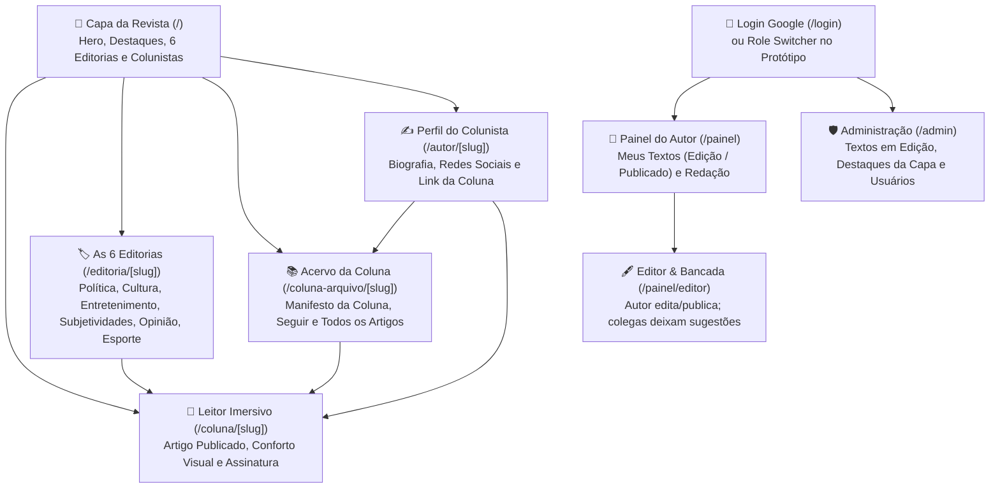

# 📘 Tutorial Completo & Manual de Uso do Sistema | Aresta Revista

> **Arquivo:** `docs/tutorial-do-sistema.md`  
> **Finalidade:** Explicar de forma didática e passo a passo a estrutura do portal, os fluxos de navegação, o ciclo de 2 status (`edicao` e `publicado`), a revisão colaborativa entre autores/admins e o uso do Seletor de Visão (`PrototypeRoleSwitcher`).  
> **Última Atualização:** 07/11/2026

---

## 📑 Sumário

- [1. Visão Geral da Estrutura do Portal (Mapa de Telas)](#1-visão-geral-da-estrutura-do-portal-mapa-de-telas)
  - [1.1 Fluxograma de Navegação](#11-fluxograma-de-navegação)
  - [1.2 Anatomia das Rotas e Componentes](#12-anatomia-das-rotas-e-componentes)
  - [1.3 Como Usar o Seletor de Visão no Protótipo (`PrototypeRoleSwitcher`)](#13-como-usar-o-seletor-de-visão-no-protótipo-prototyperoleswitcher)
- [2. Manual do Leitor: Como Navegar, Ler e Compartilhar](#2-manual-do-leitor-como-navegar-ler-e-compartilhar)
  - [2.1 Navegando pela Capa Editorial e pelas 6 Editorias](#21-navegando-pela-capa-editorial-e-pelas-6-editorias)
  - [2.2 Experiência de Leitura Imersiva (`/coluna/[slug]`)](#22-experiência-de-leitura-imersiva-colunaslug)
  - [2.3 Perfil do Colunista (`/autor/[slug]`) vs. Acervo da Coluna (`/coluna-arquivo/[slug]`)](#23-perfil-do-colunista-autorslug-vs-acervo-da-coluna-coluna-arquivoslug)
- [3. Manual do Autor / Colunista: Escrita, Revisão Colaborativa e Publicação](#3-manual-do-autor--colunista-escrita-revisão-colaborativa-e-publicação)
  - [3.1 Acessando o Painel do Autor (`/painel`)](#31-acessando-o-painel-do-autor-painel)
  - [3.2 Redigindo um Artigo: Título, Lead, Editoria, Capa JPEG e Corpo](#32-redigindo-um-artigo-título-lead-editoria-capa-jpeg-e-corpo)
  - [3.3 Comentando Textos em Edição de Outros Autores](#33-comentando-textos-em-edição-de-outros-autores)
  - [3.4 Publicando Seu Próprio Texto (`edicao` → `publicado`)](#34-publicando-seu-próprio-texto-edicao--publicado)
- [4. Manual do Administrador (`/admin`): Textos em Edição e Destaques da Capa](#4-manual-do-administrador-admin-textos-em-edição-e-destaques-da-capa)
  - [4.1 Visualizando Textos em Edição e Enviando Sugestões](#41-visualizando-textos-em-edição-e-enviando-sugestões)
  - [4.2 Montando a Grade de Destaques da Capa (Hero e Seções)](#42-montando-a-grade-de-destaques-da-capa-hero-e-seções)
  - [4.3 Gerenciando Colunistas e Permissões](#43-gerenciando-colunistas-e-permissões)
- [5. Guia Rápido de Manutenção para Desenvolvedores](#5-guia-rápido-de-manutenção-para-desenvolvedores)
  - [5.1 Onde Alterar Cada Regra, Estilo ou Dado?](#51-onde-alterar-cada-regra-estilo-ou-dado)
  - [5.2 Comandos e Validação Local](#52-comandos-e-validação-local)

---

## 1. Visão Geral da Estrutura do Portal (Mapa de Telas)

### 1.1 Fluxograma de Navegação



---

### 1.2 Anatomia das Rotas e Componentes

| Rota | Público | Finalidade Principal |
| :--- | :--- | :--- |
| **`/`** | Público Geral | Capa editorial com manchete principal (*Hero*), destaques secundários, vitrine *"Últimas das Colunas"* e feeds das 6 editorias. |
| **`/coluna/[slug]`** | Público Geral | Página de leitura imersiva para artigos com `status = 'publicado'`, controles tipográficos `[A-] [A+]`, temas, *Quote Card* e comentários. |
| **`/editoria/[slug]`** | Público Geral | Arquivo de artigos publicados filtrados por uma das **6 grandes editorias** (*Política & Poder*, *Cultura & Artes*, *Entretenimento & Pop*, *Subjetividades*, *Opinião & Ensaios*, *Esporte & Sociedade*). |
| **`/autor/[slug]`** | Público Geral | **Página de Perfil do Colunista:** biografia completa, foto, redes sociais, destaque da sua coluna titular e seus 3 textos mais recentes. |
| **`/coluna-arquivo/[slug]`** | Público Geral | **Acervo da Coluna do Autor:** banner, manifesto da coluna, botão *"Seguir esta Coluna"* e listagem cronológica completa de todos os textos publicados na coluna. |
| **`/busca`** | Público Geral | Busca em tempo real de artigos publicados por termos no título, resumo ou conteúdo. |
| **`/painel`** | Autores e Admins | Centro de controle do colunista com seus textos (`edicao` e `publicado`) e a aba *"Em Edição na Redação"* para ver e comentar textos de outros autores. |
| **`/painel/editor`** | Autores e Admins | Editor Tiptap/Markdown (editável **apenas pelo autor dono do texto**) + Painel Lateral de Sugestões de outros autores e admins. |
| **`/admin`** | Administradores | Painel administrativo para visualizar todos os textos em `edicao` (e comentar sugestões), selecionar a Manchete Hero da capa e gerenciar usuários. |

---

### 1.3 Como Usar o Seletor de Visão no Protótipo (`PrototypeRoleSwitcher`)

No link público de testes da Vercel (`aresta-revista.vercel.app`), há uma barra flutuante no canto inferior esquerdo que permite alternar em 1 clique entre os autores reais do projeto (**Lucas Campos**, **Danillo Reis**, **Sergio Rodrigues**, **Lara Lima** e **Guliver Elias**) e demais perfis:
* **✍️ Autor / Admin (Lucas, Danillo, Sergio, Lara ou Guliver):** Como **todo autor é um admin e tem sua própria coluna**, essa visão libera tanto o `/painel` (para editar e publicar textos da própria coluna) quanto o `/admin` (para gerir a capa e ver todos os textos em `'edicao'`). Ao abrir o texto em `'edicao'` de outro autor, o modo é somente leitura com envio de sugestões.
* **🛡️ Admin Não-Autor (`admin@aresta.com.br`):** Demonstra que *nem todo admin é autor*: acessa o `/admin`, escolhe os destaques da capa e comenta sugestões nos textos em `'edicao'`, mas não possui coluna própria.
* **📖 Leitor Logado:** Vê apenas artigos publicados e pode postar comentários públicos e favoritar artigos.
* **👀 Visitante Anônimo:** Simula um leitor sem login.

---

## 2. Manual do Leitor: Como Navegar, Ler e Compartilhar

### 2.1 Navegando pela Capa Editorial e pelas 6 Editorias
1. **Acesso à Capa:** Na página principal, o leitor visualiza a manchete *Hero* e os destaques curados da edição.
2. **Filtragem por Temas:** O menu superior com efeito *frosted glass* permite navegar pelas **6 editorias oficiais**:
   * **Política & Poder:** Conjuntura nacional e internacional, instituições e cidadania.
   * **Cultura & Artes:** Literatura, artes visuais, música, teatro e cinema de autor.
   * **Entretenimento & Pop:** Streaming, séries, televisão e cultura pop.
   * **Subjetividades:** Crônicas intimistas, psicanálise, memória e cotidiano.
   * **Opinião & Ensaios:** Artigos de fundo e debates teóricos aprofundados.
   * **Esporte & Sociedade:** Análises culturais do esporte e seu impacto social.

### 2.2 Experiência de Leitura Imersiva (`/coluna/[slug]`)
* O texto é apresentado em coluna centralizada (`max-w-[68ch]`) com controles `[A-]` e `[A+]` e alternância entre os temas *Papel Linho*, *Branco Puro* e *Modo Noturno*.
* Ao selecionar um trecho do texto, surge o botão flutuante **"Criar Card de Citação"** (*Quote Card*).

### 2.3 Perfil do Colunista (`/autor/[slug]`) vs. Acervo da Coluna (`/coluna-arquivo/[slug]`)
* Clique no **nome ou foto do autor** para abrir `/autor/[slug]` e conhecer sua biografia e redes sociais.
* Clique no **nome da coluna** para abrir `/coluna-arquivo/[slug]`, ler o manifesto da coluna, clicar em *"Seguir esta Coluna"* e navegar por todo o histórico de artigos publicados nela.

---

## 3. Manual do Autor / Colunista: Escrita, Revisão Colaborativa e Publicação

### 3.1 Acessando o Painel do Autor (`/painel`)
O painel do colunista organiza a rotina da redação em três abas objetivas:
1. **Em Produção:** Seus rascunhos e ensaios em fase de escrita (invisíveis no site público). Cada artigo conta com:
   * Botão **"Editar"** (`/painel/editor/[id]`);
   * Botão **"Comentários (n)"** que abre o modal de sugestões recebidas da redação com indicador de pendências;
   * Botão carmim de destaque **"Publicar Agora"** com confirmação imediata.
2. **Publicados:** Artigos de sua autoria que já estão no ar na revista, com data de publicação, link para a página pública no ar e botão de edição para correções.
3. **Redação Geral:** Textos em fase de produção (`status = 'edicao'`) dos demais colunistas da revista, com identificação do colega titular e botão **"Visualizar Texto & Comentar"**.

### 3.2 Redigindo um Ensaio: Título, Lead, Editoria, Capa Otimizada e Editor Tiptap
1. Clique em **"Novo Ensaio"** no topo do painel para abrir a página dedicada `/painel/editor/novo`.
2. Preencha Título, Subtítulo/Lead, selecione 1 das 5 Editorias Oficiais e informe as Tags.
3. Gerencie a imagem de capa:
   * Faça upload de imagem: o sistema redimensiona e comprime proporcionalmente no navegador para **JPEG (`image/jpeg`, qualidade 0.82, $\le 120\text{ KB}$)**, exibindo o selo de otimização;
   * Ou utilize em 1 clique o botão **"Usar Capa Padrão aresta."**, que aplica o asset oficial com fundo carmim `#B91C1C` e a logo dentro da pílula branca (`/images/default-cover.svg`), prevenindo qualquer falha de imagem no portal.
4. Escreva no editor WYSIWYG **Tiptap**, com barra de ferramentas para negrito, itálico, subtítulos H2/H3, citações em destaque e listas, com cálculo automático em tempo real do tempo estimado de leitura (baseado em 200 palavras/minuto).
5. Clique em **"Salvar Rascunho"** para persistir as alterações mantendo o status em produção.

### 3.3 Revisando Textos dos Colegas na Redação Geral
* Na aba **"Redação Geral"**, clique em **"Visualizar Texto & Comentar"** em qualquer artigo de outro colunista.
* A tela abrirá em **modo leitura/revisão** para proteger a autoria do colega (os botões de editar e publicar ficam bloqueados com aviso explicativo).
* Selecione qualquer trecho do texto com o mouse para citá-lo automaticamente no **Mural Lateral de Sugestões** (`EditorialReviewSidebar`) ou digite observações gerais e clique em Enviar.
* Apenas o autor titular do texto e o autor do comentário podem marcar sugestões como resolvidas.

### 3.4 Publicando Seu Próprio Texto (`edicao` → `publicado`)
* **Autonomia Total do Autor:** Quando considerar o texto pronto para o público, clique no botão carmim **"Publicar Agora"** no painel ou no topo do editor.
* **Trava de Autoria Inviolável:** O sistema valida estritamente se o usuário conectado é o autor titular (`autor_id`). Ninguém além do autor original tem autorização técnica para colocar o texto no ar.
* Assim que publicado, o artigo entra imediatamente na capa, na página da editoria, na página da coluna e no perfil do autor. Caso precise fazer ajustes depois, o autor pode reverter o artigo para o status de produção a qualquer momento.

---

## 4. Manual do Administrador (`/admin`): Textos em Edição e Destaques da Capa

### 4.1 Visualizando Textos em Edição e Enviando Sugestões
1. Acesse `/admin` e abra a aba **"Textos em Edição"**.
2. Visualize todos os artigos com `status = 'edicao'` que estão sendo preparados pelos colunistas.
3. Clique em um artigo para ler a prévia e enviar comentários/sugestões de melhoria no painel lateral para o autor original. *(Por regra editorial, o admin não altera o texto do autor nem o publica por conta própria).*

### 4.2 Montando a Grade de Destaques da Capa (Hero e Seções)
1. Na aba **"Destaques da Capa"**, são listados os artigos que já estão com `status = 'publicado'`.
2. Marque 1 artigo como **Manchete Principal (`eh_destaque_hero`)** — o sistema desmarca automaticamente o Hero anterior.
3. Marque os artigos de apoio (`eh_destaque_secao`) para compor o mosaico superior da Home.

### 4.3 Gerenciando Colunistas e Permissões
* Na aba **"Usuários & Colunas"**, promova leitores autenticados com Google para `autor` (criando sua coluna titular) ou `admin` em 1 clique.

---

## 5. Guia Rápido de Manutenção para Desenvolvedores

### 5.1 Onde Alterar Cada Regra, Estilo ou Dado?
* **Cores (`#B91C1C`), Fontes e Classes Semânticas:** `src/styles/theme.css` e [`docs/dicionario-de-dados.md`](./dicionario-de-dados.md).
* **Regras de Negócio e Fluxo `edicao`/`publicado`:** [`docs/regras-de-negocio.md`](./regras-de-negocio.md).
* **Camada de Serviços (7 Repositórios):** `src/services/` (`artigosService`, `revisaoService`, `autoresService`, `categoriasService`, `interacoesService`, `authService`, `storageService`).

### 5.2 Comandos e Validação Local
```bash
# Servidor de desenvolvimento
npm run dev

# Checagem de tipagem estrita
npx tsc --noEmit

# Análise estática com ESLint
npm run lint

# Execução de testes unitários
npm test
```
